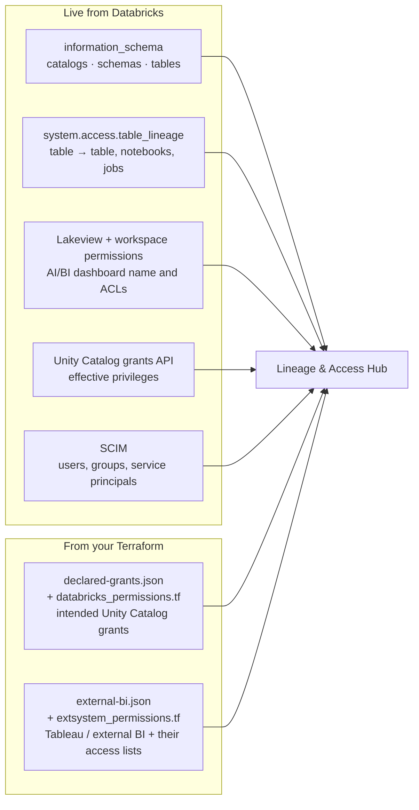
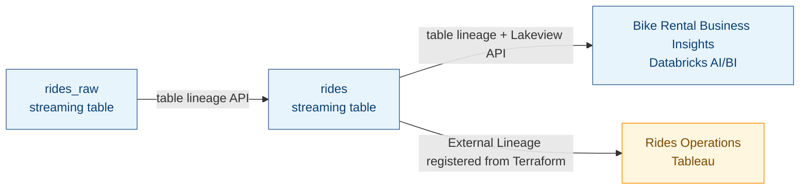

# Lineage & Access Hub

**See what feeds a table, what it feeds, and who can access it — in one Databricks App.**

Lineage & Access Hub is a workspace app for data platform and governance teams. Pick any Unity Catalog table and get a live neighborhood graph: upstream sources, downstream tables, Databricks AI/BI dashboards, and external BI tools such as Tableau. Click any node to see who can access it. Compare that live access with the grants you declared in Terraform.

The Hub does not bake in a customer catalog. You point it at **your** warehouse, catalog, schema, and Terraform folder.

## What you get

| Page | What it is for |
|---|---|
| **Lineage Explorer** | Search Unity Catalog, open a table, and walk upstream → table → downstream consumers. Expand a table for column lineage. |
| **Access panel** | Direct and inherited grants on the selected asset. Search and page through large identity lists. |
| **Permissions mapping** | Pick a user, group, or service principal and see the objects they can access — Terraform-declared first, then live Unity Catalog. |
| **Terraform source** | First-run setup: point the Hub at the workspace folder that holds your grant Terraform. Optional — Skip uses the bundled example. |

---

## How the lineage graph is built

Every node and edge has a source of truth. **Blue** comes from Databricks APIs at query time. **Amber** comes from your Terraform specification (and Unity Catalog External Lineage registered from it).



### What that looks like on a table

Example: a streaming `rides` table. Databricks already knows the pipeline tables and the AI/BI dashboard that queried it. Tableau is not in `system.access` lineage until you register it — Terraform declares that connection (and who can open the workbook).



| On the graph / access panel | Source |
|---|---|
| Catalog, schema, and table list | Databricks `information_schema` |
| Table-to-table edges | Databricks `system.access.table_lineage` |
| Notebook and job consumers | Same lineage system table (`NOTEBOOK`, `JOB`) |
| AI/BI dashboard node, display name, user ACLs | Lineage entity id + Lakeview + Workspace Permissions APIs |
| Tableau / other external BI node | Unity Catalog External Lineage, created from Terraform (`external-bi.json` / `extsystem_permissions.tf`) |
| Who **does** have Unity Catalog access | Unity Catalog effective grants API |
| Who **should** have Unity Catalog access | Terraform `declared-grants.json` (compared in Permissions mapping and the access panel) |
| Who can open an external BI asset | `access` list in `external-bi.json` — Unity Catalog has no permission model for Tableau users |

Until External Lineage is registered in the workspace, the Hub can still draw the Tableau node from the Terraform overlay so you can review the intended graph. After registration, Unity Catalog is the source of truth and the overlay is only a fallback.

---

## Install

### What you need

- Databricks CLI **v0.283.0+**, authenticated to the target workspace
- A running SQL warehouse
- Node.js 20+ only if you will run the UI locally
- Terraform 1.5+ only if you will manage the grant baseline

### Deploy to Databricks

The Hub is a Databricks App, shipped as an Asset Bundle. Substitute your catalog, schema, warehouse, and app name.

```bash
git clone <this-repo>
cd lineage_access_app
```

1. Create the Lakebase database the app uses for grant-review notes (once per workspace):

   ```bash
   ./app/scripts/lakebase_setup_db.sh --db-name dbgen_lineage_access
   ```

2. Deploy the schema, app shell, and setup job:

   ```bash
   databricks bundle deploy \
     --var catalog=<YOUR_CATALOG> \
     --var schema=<YOUR_SCHEMA> \
     --var warehouse_id=<WAREHOUSE_ID> \
     --var app_name=<YOUR_APP_NAME>
   ```

3. Run setup (Genie space, app service-principal grants, exported resource ids):

   ```bash
   databricks bundle run lineage_access_setup \
     --var catalog=<YOUR_CATALOG> \
     --var schema=<YOUR_SCHEMA> \
     --var warehouse_id=<WAREHOUSE_ID>
   ```

4. Grant the app on Lakebase, then write `app.yaml` and start the app:

   ```bash
   ./app/scripts/lakebase_grant_app_credential.sh \
     --app-name <YOUR_APP_NAME> \
     --project-id <YOUR_LAKEBASE_PROJECT> \
     --db-name dbgen_lineage_access

   ./app/scripts/finalize_app.sh
   ```

Set `DEMO_CATALOG` and `DEMO_SCHEMA` in the generated `app.yaml` to the catalog the explorer should open on. Do not commit that file — it is workspace-specific.

Full notes, re-runs, and teardown: [dab_instructions.md](./dab_instructions.md).

### First launch

Open the app URL from the workspace **Compute → Apps** page.

1. **Terraform source** asks for a workspace folder that contains:
   - `databricks_permissions.tf` — Unity Catalog grants
   - `extsystem_permissions.tf` — external lineage (Tableau and similar)
   - `declared-grants.json` — the manifest the Hub compares against live grants
2. Grant this app’s **service principal `CAN_READ`** on that folder, then **Save and continue**.
3. Or **Skip** to use the bundled example (including sample grants on `dbdemos_pipeline_bike.rides`).

---

## Use the Hub

### Lineage Explorer

1. In **Unity Catalog**, pick a catalog → schema → table (three-level name).
2. The graph loads **upstream** on the left, the selected table in the center, and **downstream** on the right.
3. Click a node to focus it. The right-hand **Access** panel lists principals for that asset.
4. Use the expand control on a table to see **column lineage**.

Databricks AI/BI dashboards that queried the table appear as consumers with their **Lakeview display name** (not the dashboard id). Tableau (and other external tools you registered) appear as consumers with the name from your Terraform spec.

### Permissions mapping

1. Search a user, group, or service principal.
2. The tree shows objects from the Terraform baseline immediately, then fills in live Unity Catalog grants.
3. Catalogs and schemas page in (25 at a time, **Load more**). Expanding a schema loads its tables.

Statuses:

| Badge | Meaning |
|---|---|
| **In sync** | Declared in Terraform and effective in Unity Catalog |
| **Declared only** | In Terraform, not effective yet (or revoked outside Terraform) |
| **Effective only** | Live in Unity Catalog, not in Terraform (UI, SQL, or another tool) |

### Local UI (optional)

```bash
cd app
npm install
npm run dev
```

Export `DATABRICKS_HOST`, `DATABRICKS_WAREHOUSE_ID`, `DEMO_CATALOG`, and `DEMO_SCHEMA` (or put them in `.env`). Open the printed local URL.

---

## Connect Terraform (recommended)

The Hub treats Terraform as the **intended** access model. Live Databricks APIs are **actual** access.

```bash
cd terraform
cp terraform.tfvars.example terraform.tfvars
# set databricks_host, databricks_profile, catalog_name, schema_name
terraform init
terraform plan
```

Leave `manage_catalog_grants=false` and `manage_external_lineage=false` until a human has reviewed the plan. Do not apply from unattended automation.

Private colleague emails belong in gitignored `terraform/.declared-grants.json`. The public `declared-grants.json` stays as a sanitized example. Terraform and the Hub prefer the hidden file when it exists.

To register Tableau (or another external tool) as real Unity Catalog lineage:

```bash
python3 app/scripts/register_external_lineage.py \
  --catalog <catalog> --schema <schema> --profile <cli-profile>
```

Or set `manage_external_lineage=true` and apply after review.

Details: [terraform/README.md](./terraform/README.md).

---

## Update the app (already deployed)

`databricks bundle deploy` recreates the Unity Catalog schema. For Hub code changes only:

```bash
./app/scripts/build-app.sh
databricks bundle sync -t prod --full --var warehouse_id=<WAREHOUSE_ID>
databricks apps deploy <APP_NAME> --source-code-path <bundle-files>/app
```

## Tests

```bash
cd app
npm test
npm run typecheck
```

## Architecture

Platform diagram (Unity Catalog + optional Tableau → lakehouse gold tables → AI/BI + Genie + this app): [architecture.md](./architecture.md).
